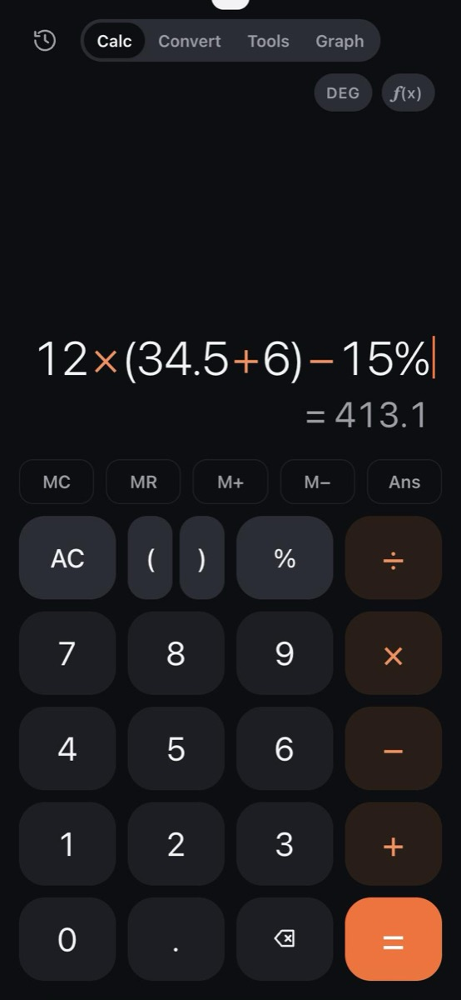
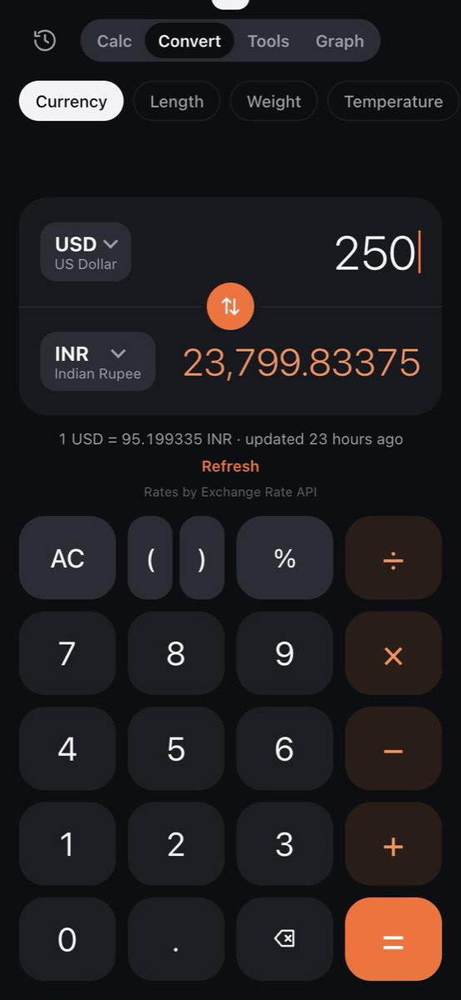
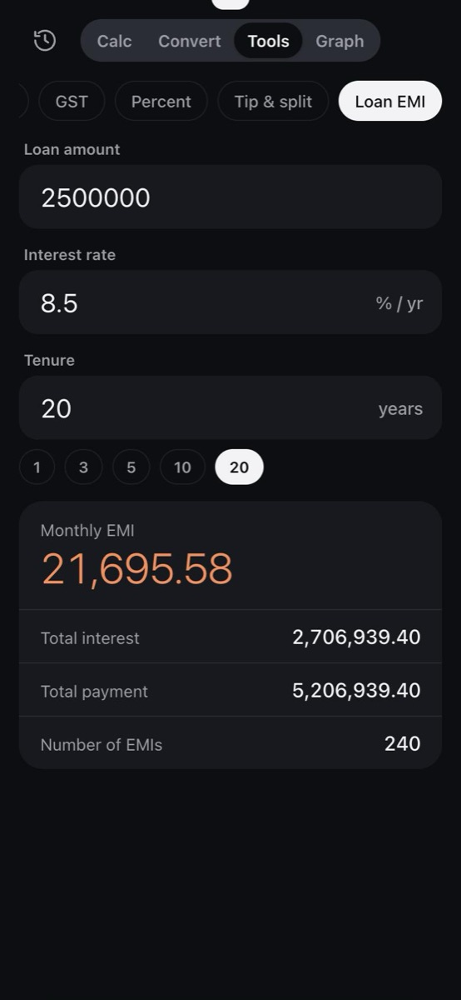
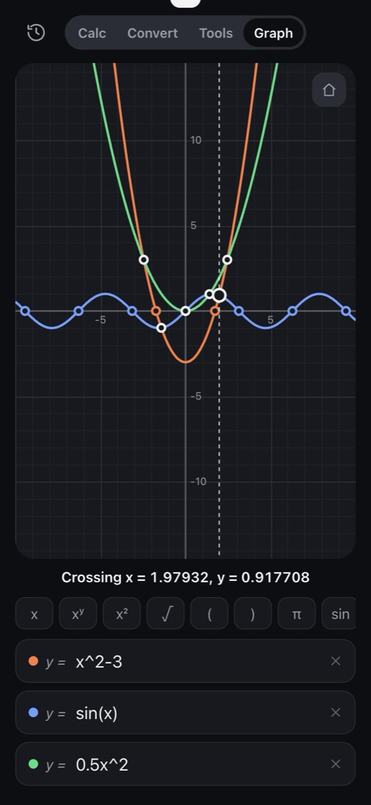

# Calculator

A fast, good-looking calculator for the phone, with history, unit and currency conversion, everyday money tools and a graphing screen. It's a web app you install from Safari, so it needs no App Store or Apple developer account.

**Open it:** https://jatinindia.github.io/calculator/

| Calculate | Convert | Tools | Graph |
|---|---|---|---|
|  |  |  |  |

## Install on iPhone

1. Open **https://jatinindia.github.io/calculator/** in **Safari**.
2. Tap **Share** → **Add to Home Screen** → **Add**.

It opens full screen with its own icon, and keeps working with no internet connection once it has been opened. On Android, open it in Chrome and choose **Install app**.

## Features

### Calculate
- Shows the answer while you type, and closes any brackets you leave open.
- Phone-style percent: `50 + 10%` = 55, `50 × 10%` = 5.
- Hides floating-point noise: `0.1 + 0.2` shows `0.3`.
- **Scientific keys** (tap **f(x)**):
  - sin, cos, tan and their inverses (via **2nd**) in degrees or radians
  - x², xʸ, √, ln, log, eˣ, 10ˣ, x!, π, e, 1/x
  - **±** and **mod** (remainder: `7 mod 3 = 1`)
- **Memory:** MC, MR, M+, M−, with a badge showing what's stored, plus **Ans** for the last answer.
- **Editing:**
  - tap anywhere in the sum to move the cursor and type or delete there
  - tap a finished sum to edit it again
  - hold **(** to wrap the whole sum in brackets, hold **−** to flip the sign
  - swipe sideways on the display to delete

### History
- Every answer is saved on your phone (up to 500), grouped by day.
- Tap a sum to edit it again, or tap an answer to use it in a new sum.
- Add a **label** to any entry ("Electricity bill") and **search** by label, sum or answer.

### Convert
- **Currency:** about 160 currencies with daily rates. The last rates are saved for use offline, and the screen shows how old they are.
- **Units:** length, weight (including tola and carat), temperature, area, volume, speed, time, data, pressure, energy and angle.
- Searchable lists for units and currencies, a swap button, and you can type sums (`12 × 3` feet).

### Tools
| Tool | What it does |
|---|---|
| Discount | Final price and how much you save |
| GST | Add or remove GST, with the CGST/SGST split (presets 3, 5, 18, 40%) |
| Percent | X% of Y, X is what % of Y, % change |
| Tip & split | Tip, total and each person's share |
| Loan EMI | Monthly EMI, total interest and total payment |
| Date | Days between two dates, or a date plus or minus N days |

Your entries are remembered. Tap the big result to copy it.

### Graph
- Plot up to three functions of `x`, such as `x^2-3`, `sin(x)` or `0.5x^2`.
- **Drag** to move, **pinch** to zoom (scroll wheel on a computer), and the home button resets the view.
- **Zeros** and **crossings** are marked. Tap a curve or a marker to read exact x and y values.
- Quick keys insert x, powers, √, brackets and functions without closing the keyboard.
- Graphs always use radians.

### Everywhere
- Light and dark themes follow your phone's setting.
- Tap any result to copy it.
- On a computer, history becomes a side panel and the keyboard works: digits, `+ - * / ^ % ! ( )`, Enter, Backspace, Esc and the arrow keys.

## Privacy

Everything stays on your device: history, labels, memory and settings are kept in the browser's local storage. The only network request is for exchange rates, made to [open.er-api.com](https://www.exchangerate-api.com) when you use the currency converter. There are no accounts, analytics or ads.

The page runs under a strict Content Security Policy: it can only load its own files and contact the exchange-rate service. Saved data and exchange rates are validated before use and are only ever shown as text, never as HTML.

## Development

The app is plain HTML, CSS and JavaScript (ES modules), with no dependencies and no build step.

```bash
npm start   # serve at http://localhost:8080
npm test    # run the unit tests (Node 20+)
```

To try it on a phone on the same Wi-Fi, run `npm start` and open `http://<your-computer's-ip>:8080`. Offline mode only works over HTTPS, as on the live site.

### Releasing a change

1. Make the change and run `npm test`.
2. In `sw.js`, bump `VERSION` (for example `calc-v6` → `calc-v7`). Otherwise installed copies keep serving the old files from their offline cache.
3. Push to `main`. GitHub Pages republishes within a minute or two.

### Project layout

| File | Role |
|---|---|
| `index.html`, `styles.css` | Page structure and design |
| `app.js` | App state, rendering, storage and event handling |
| `calc.js` | Safe expression parser and evaluator (never uses `eval`), number formatting |
| `editor.js` | What each key does to the expression, including editing at a cursor |
| `history.js` | History search and labels |
| `convert.js` | Unit definitions, currency maths, exchange-rate response checks |
| `tools.js` | Discount, GST, percent, tip, EMI and date maths, plus the Tools form definitions |
| `graph.js` | Zeros, intersections and grid spacing |
| `graph-view.js` | Graph canvas: drawing, pan, pinch-zoom, tap-to-trace |
| `sw.js`, `manifest.webmanifest`, `icons/` | Offline support and home-screen install |
| `*.test.js` | Unit tests (`node --test`) |

## Limitations

- The graph plots `y = f(x)` only. It doesn't do circles or other implicit equations, 3D surfaces, or systems of equations.
- Currency rates update once a day. They're fine for everyday use, not for trading.

## Credits

Exchange rates are provided by [Exchange Rate API](https://www.exchangerate-api.com).

## License

[MIT](LICENSE) © Jatin Grewal
